

<a href="https://www.uni-leipzig.de/en">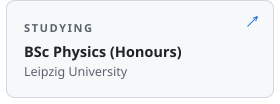</a><a href="https://choreolabs.com/">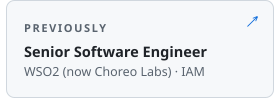</a>

<a href="https://github.com/BimsaraBodaragama"></a>

<a href="https://www.uni-leipzig.de/en">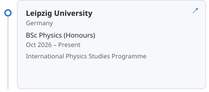</a>
<a href="https://cmb.ac.lk/"></a>
<a href="https://thesoftwarepractice.com/"></a>
<a href="https://github.com/BimsaraBodaragama">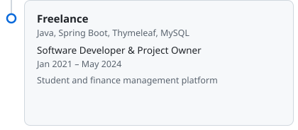</a><a href="https://www.linkedin.com/school/maris-stella-college-negombo/">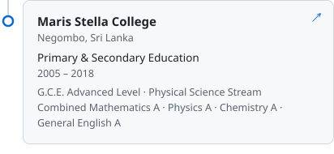</a>

<a href="https://www.ecsl.gov.lk/">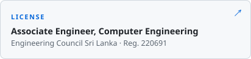</a>

<a href="https://www.coursera.org/account/accomplishments/verify/CPLPU4TDPV5X">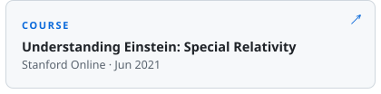</a>
<a href="https://github.com/BimsaraBodaragama">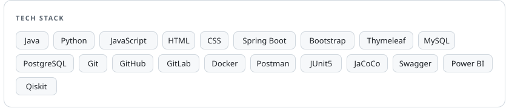</a>
<a href="https://github.com/BimsaraBodaragama">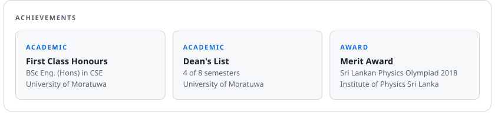</a>

